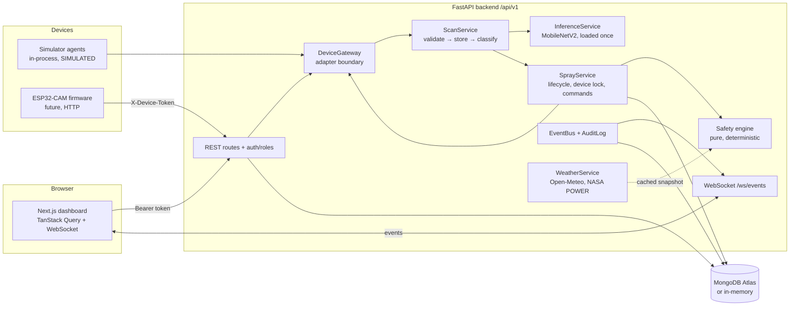

# Architecture

## Components

| Layer | Module | Responsibility |
|---|---|---|
| Core | `app/core/` | Settings (validated env), JSON logging + request IDs, error envelope, auth primitives (scrypt, HMAC tokens), rate limiter |
| DB | `app/db/client.py` | MongoDB/Atlas or mongomock (same PyMongo API), ping, indexes (incl. TTL) |
| Schemas | `app/schemas/` | Pydantic request/response models, device contract v1 |
| ML | `app/ml/preprocessing.py` | Single preprocessing implementation shared by training and serving |
| Services | `inference`, `images`, `scans`, `safety`, `spray`, `devices` (+commands), `policy` (+e-stop), `users`, `weather`, `analytics`, `audit`, `events`, `retention` | Business logic; no HTTP concerns |
| Adapters | `adapters/gateway.py` | The one entry point for device-originated actions (heartbeat, scan upload, poll, ack, result, disconnect) |
| | `adapters/simulator.py` | Simulated ESP32 agents that call the gateway exactly like firmware would |
| Routes | `app/routes/` | Thin HTTP layer: auth, devices + simulator, device API, scans, spray/safety, dashboard/insights, WebSocket |
| Container | `services/container.py` | Wires services; background loop (simulator ticks, connectivity + operation sweeps, weather refresh, retention) |

## Key flows

**Scan → decision.** Upload is size/MIME/extension checked, decoded with a decompression-bomb guard,
re-encoded as JPEG (EXIF stripped) under a server-generated name. Quality heuristics (brightness,
sharpness, leaf-coloured area) add warnings. `InferenceService.classify` applies the policy threshold and
top-2 margin; anything ambiguous becomes `UNCERTAIN`. `SprayService.decide_for_scan` builds a
`SafetyContext` snapshot and calls `safety.evaluate`; an operation record is created only when spraying is
actually in question (disease detected and not review-required).

**Approval → spray.** Approval re-reads the current state and re-evaluates *all* rules. If authorized, the
service atomically claims the device (`devices.active_operation_id`, conditional update, so it is safe across
processes), enqueues a `SPRAY` command with an ack deadline, and marks the operation `DISPATCHED`. The device
polls, acknowledges (`RUNNING`), runs the pump for the bounded duration, and reports a result (`COMPLETED` /
`FAILED`). A background sweep fails operations whose commands are not acknowledged in time and sends a
precautionary `STOP` when a running operation never reports completion.

**Emergency stop.** Persisted flag; activation aborts every open operation, cancels queued `SPRAY` commands,
and queues `STOP` (priority-delivered) to every device. While active, the safety rule blocks everything and
heartbeat responses tell devices `emergency_stop_active: true`. Only an admin can reset.

**Real time.** Services publish to an in-process `EventBus` (thread-safe); `/ws/events` streams events to
the dashboard, which invalidates the relevant TanStack Query caches (coalesced) and feeds the live views.

## Collections (`agriguard_db`)

| Collection | Notes / indexes |
|---|---|
| `devices` | token hash (unique, sparse), last_seen; `active_operation_id` = device lock |
| `device_commands` | (device_id, status, created_at); expires_at for ack deadlines |
| `telemetry` | (device_id, ts); **TTL 7 days** |
| `scans` | created_at, (device_id, created_at), prediction.label, decision.outcome, idempotency_key (unique, sparse) |
| `spray_events` | (status, created_at), (device_id, created_at), scan_id; embedded history = audit trail |
| `system_logs` | **TTL = LOG_RETENTION_DAYS**; (category, ts) |
| `users` | username unique; scrypt hashes |
| `settings` | `spray_policy` (versioned), `emergency_stop` |
| `weather_records` | (key, fetched_at); last good external responses |

All timestamps are timezone-aware UTC (millisecond precision). IDs are readable strings (`scan_…`, `op_…`).

## Design decisions

- **Polling command delivery** (not push): works behind NAT/mobile hotspots, identical for simulator and
  ESP32, at-least-once with device-side de-duplication by command id.
- **mongomock fallback**: one code path for Atlas and local demo; the UI and readiness endpoint always
  disclose non-persistent mode. A configured-but-unreachable Atlas is reported, never masked.
- **Python-side analytics aggregation** over bounded, projected queries: identical behaviour on both
  backends; adequate for prototype volumes (documented cap of 20,000 records per query).
- **Stdlib crypto** (scrypt, HMAC) instead of extra JWT/passlib dependencies.
- **Model loaded once** in a background thread at startup so the API is responsive while TensorFlow starts.
